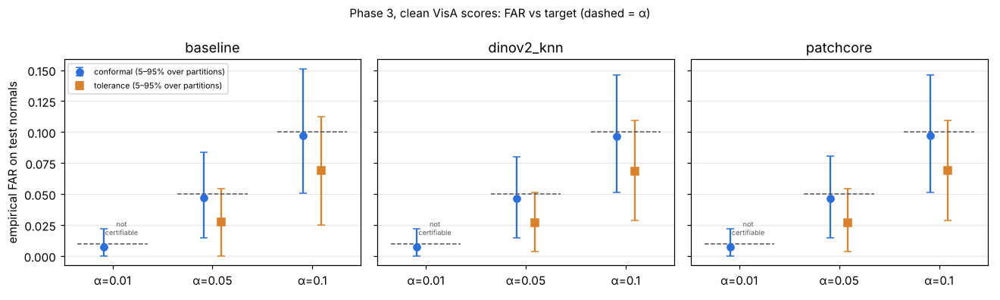
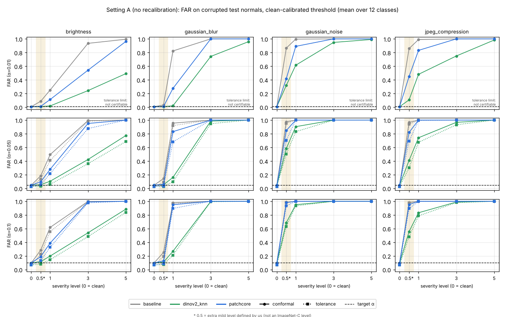
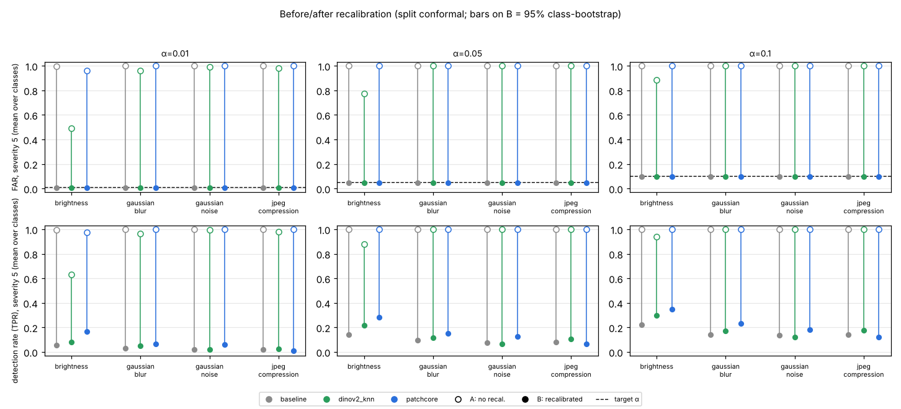

# Conformal False-Alarm Calibration for Industrial Anomaly Detection under Distribution Shift

[](https://github.com/shayansalehi1381/anomaly-calibration/actions/workflows/ci.yml)


Industrial anomaly detectors are usually compared by AUROC, but a deployed detector needs
a **threshold**, and the number operators feel is the **false-alarm rate** on good
parts. This project calibrates that threshold with **split conformal prediction** on
normal images only, which gives a finite-sample, distribution-free guarantee
`E[false-alarm rate] ≤ α`. It then tests whether the guarantee **survives
distribution shift** (illumination, blur, noise, JPEG) for three detectors on
**VisA**: a feature-distance baseline, PatchCore and DINOv2-kNN.

> **TL;DR: status: Phases 0–4 done (Phase 5 next).** On clean VisA scores, split-conformal
> thresholds hit their false-alarm targets for all three detectors (e.g. 4.6–4.7% at α = 5%),
> as theory predicts; the PAC tolerance limit cannot certify α = 1% with our 138–277
> calibration normals per class. Under our synthetic corruptions, a threshold calibrated on
> clean images **stops holding its target almost immediately** (PatchCore at severity 1: FAR 28% for brightness and 83–100% for
> the other corruptions, instead of 5%), DINOv2-kNN degrades least, and recalibrating on
> corrupted normals restores the FAR exactly but leaves a detector that catches few anomalies.
> Every number here comes from a real run and
> is labelled measured or estimated. This is a reproduction plus
> extension of existing work, not a novelty claim (see [Prior work](docs/PRIOR_WORK.md)).

---

## Contents
- [Research question](#research-question)
- [Motivation](#motivation)
- [Relation to prior work](#relation-to-prior-work)
- [Method (planned)](#method-planned)
- [Results](#results)
- [Limitations](#limitations)
- [Reproducibility](#reproducibility)
- [Project layout](#project-layout)
- [Roadmap](#roadmap)
- [References](#references)

## Research question

Do conformally calibrated anomaly-score thresholds keep their target false-alarm rate
(α = 1% and 5%) under distribution shift, and which detection method keeps it most
stably?

## Motivation

- **AUROC does not choose a threshold.** Two detectors with the same AUROC can have very
  different false-alarm rates at any given operating point.
- **Picking a threshold "by eye" on validation data has no guarantee.** Split conformal
  calibration does: if calibration and test normals are exchangeable, the expected
  false-alarm rate is at most α, for any detector and any score distribution
  ([math](docs/INTERVIEW_NOTES.md#2-split-conformal-threshold-the-math)).
- **Factories are not exchangeable.** Lighting drifts, cameras defocus, sensors get noisy,
  images get compressed. The guarantee rests on one assumption, and this assumption is
  exactly what breaks under shift. We measure by how much, per method and per class, and
  how many shifted normal images are needed to recalibrate.

## Relation to prior work

**Reproduction plus extension; no novelty claim.** Details: [docs/PRIOR_WORK.md](docs/PRIOR_WORK.md).

- **Deng (arXiv:2608.15090)** calibrates industrial AD thresholds with a one-sided
  order-statistic **tolerance limit**: the smallest rank r with
  Pr{Binomial(m, α) ≥ m − r + 1} ≥ 1 − δ, and τ = S₍ᵣ₎. This gives the PAC guarantee
  Pr_cal[P₀{S > τ} ≤ α] ≥ 1 − δ, valid with ties. Deng evaluates it on ISP-AD and Magnetic
  Tile with PatchCore, DINOv2 patch memory and a PaDiM-style detector, and reports Wilson
  intervals for the realised FPR. The paper states that the guarantee does not extend
  to domain shift and **does not test shift**. **Our PAC threshold is Deng's tolerance
  limit, credited as such**; we reproduce his primary setting (m = 150, α = 0.10,
  δ = 0.05 → r = 142, confidence 0.9693).
- **SPARC (Han, Chu, Nowak, Chin; arXiv:2608.18585)** corrects *features* under shift with
  a gradient-free per-cell subspace projection, built from ≤ 8 verified-normal images of
  the deployment lot. It reports image AUROC and AU-PRO only, with **no threshold
  calibration and no false-alarm guarantee**. It classifies **VisA as shift-free**. Its
  VisA image AUROC (PatchCore WRN-50 about 94.3, AnomalyDINO about 95.3; resize + center
  crop) serves **only as a sanity check** for our detectors.
- **What we add:** we measure how calibrated thresholds, split-conformal (marginal,
  E[FAR] ≤ α) and tolerance-limit (PAC), behave under **controlled synthetic shifts on
  VisA**, and how much **recalibration on a small set of shifted normals** restores the
  target false-alarm rate.

**How small is "small"? (derived by us from standard theory)** With n calibration
normals, split conformal can certify at best **α_min = 1/(n+1)**: n = 8 → 11.1%,
n = 99 → 1%. The tolerance limit needs **m ≥ m_min = ⌈log δ / log(1 − α)⌉** normals:
299 for α = 1%, δ = 5%. Derivations are in
[docs/INTERVIEW_NOTES.md](docs/INTERVIEW_NOTES.md#smallest-certifiable-α-for-a-given-number-of-calibration-normals-derived-by-us).

## Method (planned)

1. **Detectors**, fit on a memory bank of normal training images per class (design choices
   in [docs/MODELS.md](docs/MODELS.md)):
   - *baseline*: global WRN-50 features, distance to the nearest memory image;
   - *PatchCore* (our lean torch implementation, no faiss): WRN-50 layer2+3 patch features,
     a 10% greedy coreset, exact nearest-neighbour patch distance (float32 shortlist +
     exact re-rank, after a float32 cancellation bug we hit in Phase 1), max over patches;
   - *DINOv2-kNN*: DINOv2 ViT-S/14 patch tokens, cosine nearest neighbour, mean of the
     top 1% patches.
   Image AUROC, pixel AUROC and PRO (up to FPR 0.3) are computed by our own tested code.
2. **Two thresholds** from held-out normal calibration images, strictly disjoint from the
   memory bank and from the test images: split conformal (marginal) and Deng's tolerance
   limit (PAC).
3. **Clean evaluation** over R = 100 random calibration/test partitions: empirical FAR vs α
   with **Wilson 95% intervals**, its distribution vs the theoretical Beta law, and
   detection rate at the threshold.
4. **Shift evaluation**: 4 corruptions × configurable severities, applied deterministically
   on the laptop. We measure FAR drift and detection rate.
5. **Mitigation**: recalibrate on m shifted normals and measure how much of the guarantee
   comes back.

Details and justification: [ROADMAP.md](ROADMAP.md).

## Results

### Phase 2: detector accuracy on clean images (measured; not the main result)

Laptop GPU run: 12 classes × 2 protocols × 3 seeds × 3 methods × 13 conditions, 764,064
scored image-conditions in **3 h 53 min** (the estimate was 3 h 44 min). Clean image
AUROC (%), class mean over 12 classes, mean ± std over 3 seeds:

| protocol | baseline | DINOv2-kNN | PatchCore |
|---|---:|---:|---:|
| official VisA split (memory = all train normals) | 80.4 | 89.6 | 90.0 |
| our calib split (memory = ½ train normals) | 80.0 ± 0.1 | 89.8 ± 0.3 | 89.6 ± 0.3 |

Pixel AUROC / PRO (official split): PatchCore 97.7 / 82.8, DINOv2-kNN 94.8 / 72.7.
Per-class tables, run facts and caveats: [docs/RESULTS_EXTRACTION.md](docs/RESULTS_EXTRACTION.md).

**Sanity check vs SPARC** (different preprocessing): PatchCore 90.0 vs ~94.3 (−4.3);
DINOv2-kNN 89.6 vs AnomalyDINO ~95.3 (**−5.7, flagged; not explained**, see Limitations).
Both patch methods are weak on **macaroni2** (PatchCore near chance) and **capsules**.
This lowers detection power there; it does not affect the false-alarm guarantees, which
use normal scores only.

### Phase 3: calibrated false-alarm rates on clean images (measured)

Setup: `calib` protocol, clean images only. For each (method, seed, class) = 108
experiments, the held-out normal pool is split R = 100 times at random into
calibration and test halves (n_cal = 138–277 per class). Thresholds are computed from the
calibration half only; FAR is measured on the test half. Code: `src/anomcal/calibration.py`,
`src/anomcal/phase3.py`; outputs in `results/phase3/`. Reproduce on CPU in about 1 minute
with `python -m anomcal.phase3`.

Pooled empirical FAR over all classes, seeds and partitions, with Wilson 95% interval,
next to the exact theoretical mean (Beta-binomial law):

| method | α | split conformal: FAR [Wilson] | theory | tolerance limit (δ = 5%): FAR [Wilson] | theory | detection rate at conformal α |
|---|---|---|---|---|---|---|
| baseline | 1% | 0.73% [0.71, 0.75] | 0.71% | not certifiable | – | 19.5% |
| baseline | 5% | 4.69% [4.64, 4.73] | 4.58% | 2.75% [2.71, 2.78] | 2.61% | 39.1% |
| baseline | 10% | 9.75% [9.68, 9.81] | 9.61% | 6.92% [6.87, 6.98] | 6.63% | 51.4% |
| DINOv2-kNN | 1% | 0.71% [0.70, 0.73] | 0.71% | not certifiable | – | 37.6% |
| DINOv2-kNN | 5% | 4.61% [4.57, 4.66] | 4.58% | 2.69% [2.66, 2.73] | 2.61% | 64.3% |
| DINOv2-kNN | 10% | 9.65% [9.59, 9.72] | 9.61% | 6.86% [6.81, 6.92] | 6.63% | 72.9% |
| PatchCore | 1% | 0.71% [0.70, 0.73] | 0.71% | not certifiable | – | 41.4% |
| PatchCore | 5% | 4.67% [4.63, 4.72] | 4.58% | 2.71% [2.67, 2.74] | 2.61% | 65.0% |
| PatchCore | 10% | 9.73% [9.67, 9.80] | 9.61% | 6.90% [6.84, 6.95] | 6.63% | 73.5% |



**Certifiable?** Split conformal certifies α = 1%, 5% and 10% in every class (smallest
certifiable α = 1/(n+1) ≤ 0.72%). The tolerance limit (δ = 5%) certifies 5% and 10% in
every class and **1% in none** (it needs m ≥ 299; we have 138–277). This is the expected
outcome, now verified with the real n values. Those cells are reported as
"not_certifiable"; no threshold is faked.

**How to read this (caveats):**
- On clean data with random splits of a fixed pool, the false-alarm count follows the
  Beta-binomial law *exactly*, for any detector (only the ranks matter). The agreement
  above therefore mainly checks our implementation. The informative test is Phase 4
  (shift), where exchangeability is broken by construction.
- One test set is noisy: in about 29–45% of partitions the empirical FAR exceeds α under
  split conformal (theory: 29–43%). The guarantee is an *average*, and the 5–95% range
  across partitions spans about ±3 points at α = 5%. The tolerance limit exceeds α in
  8–11% of partitions (theory: 9–10%), which is the price of measuring on 137–277 test
  images, not a violation of Pr[true FAR ≤ α] ≥ 95%.
- Wilson intervals assume independent test images, but the 100 partitions reuse the same
  pool, so these intervals are too narrow. The pooled FAR is 0–5% (relative) above the
  theoretical mean (most visible for the tolerance limit), still below α everywhere.
- Goodness of fit (simulated KS against the exact law): 33 of 540 tests reject at 5%
  (6.1%; p = 0.14 against the expected 5%). In the α = 1% subgroup it is 12 of 108 (11.1%),
  borderline after correcting for picking that subgroup. Unexplained; the same procedure
  rejects 4.0% on synthetic data where the law holds by construction.
- **Cross-split check** (a real-data test): calibrate on held-out *train* normals, test on
  the *official test* normals, which VisA collected separately. DINOv2-kNN gets 11.4%
  [10.3, 12.6] at α = 10% (expected 9.9%) and 5.6% at α = 5% (expected 4.9%); PatchCore
  10.9% at α = 10%. This is a weak hint that VisA's test normals score slightly higher than
  its train normals, a small natural shift. It is not conclusive: the 3 seeds reuse the
  same test images, and per-experiment tests rarely reject.
- Detection power varies a lot by class: at a conformal α = 5%, PatchCore catches 95.5% of
  anomalies on chewinggum but 6.1% on macaroni2 (`results/phase3/per_class.csv`).
- VisA has no engineered shift, our shifts (Phase 4) are synthetic, and conformal relies
  on exchangeability. Reproduction plus extension, no novelty claim.

### Phase 4: does the threshold keep its FAR under corruption? (measured)

Same design as Phase 3 (protocol `calib`, 108 experiments = 3 methods × 3 seeds × 12
classes, 100 random 50/50 partitions each, the same partition for every corruption).
Four corruptions × severities 1, 3, 5 (exact parameters: `src/anomcal/corruptions.py`, also in each `run_meta.json`), thresholds from
the normal calibration half only, FAR measured on the **corrupted** test normals, TPR on the
corrupted anomalies.

- **Setting A, no recalibration:** threshold from the clean calibration normals. Calibration
  and test normals are *not* exchangeable here **by construction**, so the guarantee does not
  apply; we measure how far it breaks.
- **Setting B, recalibration:** threshold from corrupted calibration normals of the same
  corruption and severity. This **needs normal images under the new condition**, which a
  deployed system may not have.

Split conformal, α = 5%; cell = FAR (excess FAR = FAR − α), mean over 12 classes
(`results/phase4/headline.csv` has all α, both threshold kinds, 95% intervals and the worst class):

| corruption | method | A sev 1 | A sev 3 | A sev 5 | B sev 1 | B sev 3 | B sev 5 |
|---|---|---|---|---|---|---|---|
| brightness | baseline | 0.494 (+0.444) | 0.993 (+0.943) | 1.000 (+0.950) | 0.046 (-0.004) | 0.045 (-0.005) | 0.046 (-0.004) |
| brightness | dinov2_knn | 0.104 (+0.054) | 0.422 (+0.372) | 0.773 (+0.723) | 0.045 (-0.005) | 0.046 (-0.004) | 0.046 (-0.004) |
| brightness | patchcore | 0.279 (+0.229) | 0.951 (+0.901) | 1.000 (+0.950) | 0.046 (-0.004) | 0.046 (-0.004) | 0.046 (-0.004) |
| gaussian_blur | baseline | 0.955 (+0.905) | 1.000 (+0.950) | 1.000 (+0.950) | 0.046 (-0.004) | 0.046 (-0.004) | 0.046 (-0.004) |
| gaussian_blur | dinov2_knn | 0.160 (+0.110) | 0.985 (+0.935) | 1.000 (+0.950) | 0.045 (-0.005) | 0.046 (-0.004) | 0.045 (-0.005) |
| gaussian_blur | patchcore | 0.831 (+0.781) | 1.000 (+0.950) | 1.000 (+0.950) | 0.045 (-0.005) | 0.046 (-0.004) | 0.046 (-0.004) |
| gaussian_noise | baseline | 1.000 (+0.950) | 1.000 (+0.950) | 1.000 (+0.950) | 0.046 (-0.004) | 0.046 (-0.004) | 0.046 (-0.004) |
| gaussian_noise | dinov2_knn | 0.904 (+0.854) | 1.000 (+0.950) | 1.000 (+0.950) | 0.045 (-0.005) | 0.046 (-0.004) | 0.046 (-0.004) |
| gaussian_noise | patchcore | 1.000 (+0.950) | 1.000 (+0.950) | 1.000 (+0.950) | 0.045 (-0.005) | 0.046 (-0.004) | 0.046 (-0.004) |
| jpeg_compression | baseline | 1.000 (+0.950) | 1.000 (+0.950) | 1.000 (+0.950) | 0.046 (-0.004) | 0.046 (-0.004) | 0.046 (-0.004) |
| jpeg_compression | dinov2_knn | 0.741 (+0.691) | 0.967 (+0.917) | 1.000 (+0.950) | 0.045 (-0.005) | 0.045 (-0.005) | 0.045 (-0.005) |
| jpeg_compression | patchcore | 1.000 (+0.950) | 1.000 (+0.950) | 1.000 (+0.950) | 0.046 (-0.004) | 0.046 (-0.004) | 0.046 (-0.004) |

Detection rate (TPR) on the corrupted anomalies at that threshold, and the image AUROC
*within* the condition (normals and anomalies both corrupted). Clean AUROC (class mean, over
3 seeds): baseline 80.0, DINOv2-kNN 89.8, PatchCore 89.6.

| corruption | method | TPR A sev 1/3/5 | TPR B sev 1/3/5 | AUROC within condition sev 1/3/5 |
|---|---|---|---|---|
| brightness | baseline | 0.72/0.99/1.00 | 0.31/0.15/0.14 | 75/60/59 |
| brightness | dinov2_knn | 0.63/0.73/0.88 | 0.57/0.37/0.21 | 87/77/67 |
| brightness | patchcore | 0.72/0.97/1.00 | 0.60/0.45/0.28 | 86/73/64 |
| gaussian_blur | baseline | 0.98/1.00/1.00 | 0.17/0.06/0.09 | 63/46/51 |
| gaussian_blur | dinov2_knn | 0.70/1.00/1.00 | 0.57/0.22/0.12 | 87/64/53 |
| gaussian_blur | patchcore | 0.98/1.00/1.00 | 0.61/0.27/0.15 | 84/62/57 |
| gaussian_noise | baseline | 1.00/1.00/1.00 | 0.14/0.08/0.08 | 59/51/51 |
| gaussian_noise | dinov2_knn | 0.97/1.00/1.00 | 0.25/0.11/0.07 | 64/51/50 |
| gaussian_noise | patchcore | 1.00/1.00/1.00 | 0.36/0.21/0.13 | 67/59/55 |
| jpeg_compression | baseline | 1.00/1.00/1.00 | 0.18/0.15/0.08 | 61/55/53 |
| jpeg_compression | dinov2_knn | 0.91/0.99/1.00 | 0.30/0.19/0.11 | 69/61/54 |
| jpeg_compression | patchcore | 1.00/1.00/1.00 | 0.28/0.14/0.06 | 67/55/49 |

**Stability ranking** (`results/phase4/stability.csv`; root-mean-square of FAR − α over the 12
shifted conditions and 12 classes, 0 = target kept everywhere; lower is more stable):

| setting, α = 5% conformal | baseline | PatchCore | DINOv2-kNN |
|---|---|---|---|
| A: no recalibration, RMS excess FAR (95% class-bootstrap) | 0.919 (0.911–0.930) | 0.902 (0.891–0.913) | **0.799 (0.766–0.828)** |
| A: spread of FAR across classes / across seeds | 0.038 / 0.003 | 0.058 / 0.006 | 0.143 / 0.011 |
| B: recalibrated, RMS excess FAR | 0.0048 | 0.0047 | 0.0050 |

What we measured:

- **No recalibration, the target is not kept.** At α = 5%, every method has FAR 97–100% by
  severity 3 for blur, noise and JPEG. Only brightness (all methods at severity 1) and
  DINOv2-kNN at blur severity 1 (16%) stay moderate.
  DINOv2-kNN is the most stable in all 5 certifiable (kind, α) cells (mean rank 1.0, then
  PatchCore, then the baseline). It is clearly ahead of both others, while PatchCore and the
  baseline overlap at α = 5% (intervals above). Its RMS excess is ~11% lower than PatchCore's
  at α = 5%, but it is still ≈ 0.8, i.e. "least bad". **All three fail.** Caution on the word
  "stable": the baseline has the *smallest* spread across classes (0.038 vs 0.143 for
  DINOv2-kNN) simply because it is broken uniformly (FAR ≈ 100% in every class). By spread
  alone the ranking would invert, so we rank by distance from the target.
- **Tolerance limit (δ = 5%) behaves like conformal under shift**: slightly lower FAR, same
  picture (it is a slightly higher order statistic, hence a slightly higher threshold). At
  α = 1% it is *not certifiable* (it needs 299 calibration normals, we have 138–277) and is
  reported as such, never clamped.
- **The aggregate hides large class differences.** Brightness severity 1 (PatchCore, α = 5%):
  FAR is 6–8% for seven classes (capsules, fryum, macaroni1/2, pcb1–3), 11% for pcb4, 38–43% for
  candle and cashew, and 96–100% for pipe_fryum and chewinggum (`per_class.csv`). Capsules and
  macaroni2 (the weak PatchCore classes) stay near 5–6% for all three methods in this
  condition. We did **not** test why; they have weak clean AUROC, so "stable" there does not
  mean "good".
- **With recalibration the FAR is back on target, for every method, class, corruption and
  severity**: mean FAR is 0.3–0.5 percentage points *below* α for conformal, as the finite-sample
  theory says (E[FAR] ≥ α − 1/(n+1)); no (method, class, condition) cell deviates by more than 1.3 points
  (`per_class.csv`). The *violation rate* (share of partitions with FAR > α) is about 40%
  at α = 5% in B, which is expected: a guarantee on the **average** FAR does not bound each
  partition; the tolerance limit's violation rate in B is 8.6–10% (its design target is ≤ 5% per
  *calibration set*; we measure it on a finite test half, so slightly higher is plausible, not
  verified). In A it is 85–99.5%.
- **Recalibration fixes the FAR but not the detector.** At severity 3–5 the within-condition AUROC
  is 46–77 (near chance for noise and JPEG), and TPR at the recalibrated threshold falls from
  39–65% (clean, α = 5%) to 6–28% at severity 5 (brightness: 14–28%). In A, TPR is ~100% only because
  *everything* raises an alarm. So "keeps the false-alarm rate" and "is still useful" are
  different questions. Ranking in B is meaningless: all three methods are within each other's
  intervals.

How the uncertainty was computed, and what it misses. The Phase 3 Wilson intervals were too
narrow because the 100 partitions reuse the same images. For the headline numbers we instead
use a **bootstrap over classes**: the 12 per-class values (each already averaged over the 3 seeds
and 100 partitions) are resampled with replacement 2,000 times, the same draw for every method,
and we report the 2.5–97.5% range. It covers "which VisA classes happened to be in the study".
It does **not** cover other datasets or objects, other corruption strengths than our three, the
sampling of images *within* a class (138–277 test normals each; the partitions reuse them), the
seeds beyond their contribution to the class averages, or the fact that the corruptions are
synthetic. With 12 classes it is itself rough. We also did not compute paired difference
intervals between methods; "clearly ahead" above means non-overlapping marginal intervals.

Caveat on scope: our corruptions are synthetic and strong (JPEG quality 25 at severity 1;
see `src/anomcal/corruptions.py`), and we did not check whether they are realistic
for a factory line. Severity 1 already moves normal scores by many clean standard deviations
(e.g. PatchCore on candle: clean 0.65 ± 0.08, JPEG severity 1: 1.49 ± 0.04; a diagnostic
on 2 classes, one seed), so the collapse in setting A is not surprising in hindsight. We
did not test what makes the detectors sensitive.




Phase 5 (final write-up) follows.

## Limitations

Known up front; the list will grow as results come in.

- **VisA contains no engineered shift, and our shifts are synthetic.** SPARC classifies
  VisA as shift-free. Our corruptions (brightness, blur, noise, JPEG) are controlled
  stand-ins for acquisition changes; real shifts (a new product lot, a new camera) may
  behave differently, and we make no claim about natural shift.
- **Shift breaks the assumption by construction.** Split conformal and the tolerance
  limit both rely on calibration and test normals being exchangeable (i.i.d. for the
  tolerance limit). A shifted test set violates this *by design*, so "the guarantee
  fails under shift" is expected. What we measure is *by how much*, for which methods,
  and what recalibration recovers.
- **Few normal test images per class in the official VisA split**: 50–101 per class
  (962 in total; verified from `split_csv/1cls.csv`, see
  [docs/SPLIT_PROTOCOL.md](docs/SPLIT_PROTOCOL.md)). We therefore enlarge the normal pool
  with half of the training normals, which leaves a memory bank half the standard size.
  AUROC is reported on both protocols and labelled clearly.
- **The PAC (tolerance-limit) guarantee at α = 1% is out of reach with our split.**
  n_cal ≈ 138–277 per class (at a 50/50 calibration/test partition), but it needs
  m_min = 299 at δ = 5%. α = 5% (m_min = 59) is reachable, and so is the marginal guarantee
  at α = 1% (n ≥ 99). This is known before running anything, and the results will say so.
- **Corruption strength is approximate.** We use ImageNet-C parameters (defined at 224 px)
  at our 256 px canonical resolution, and resize VisA's non-square images to squares.
- **Small-sample limits are real (derived by us).** Split conformal certifies at best
  α = 1/(n+1), and the tolerance limit needs m ≥ ⌈log δ / log(1 − α)⌉. With 8 shifted
  normals, recalibration can certify at best α ≈ 11.1% (split conformal) or about 31%
  (tolerance limit, δ = 5%), so it **cannot** restore a 1% guarantee.
- **DINOv2-kNN is 5.7 points below the AnomalyDINO reference (known limitation, unexplained).**
  Hypotheses only: our 224 px input, our top-1% aggregation, square resizing instead of a
  center crop, no masking. AnomalyDINO's exact setup could not be read from our
  environment. A cheap one-class check at 448 px is listed as optional future work
  ([docs/RESULTS_EXTRACTION.md](docs/RESULTS_EXTRACTION.md)).
- **Weak classes:** macaroni2 (PatchCore 55.7–59.4 AUROC) and capsules (70.2–73.4). Web
  sources suggest these are hard for PatchCore on VisA in general; that is unverified by us.
- **Our PatchCore and DINOv2-kNN are lean re-implementations**, not the reference code:
  PatchCore without the paper's score re-weighting and with a simplified channel pooling;
  DINOv2-kNN at 224 px without AnomalyDINO's background masking. Details and reasons are in
  [docs/MODELS.md](docs/MODELS.md). The pretrained weights cannot be downloaded in the cloud,
  so real-weight behaviour is verified only by the laptop smoke test.
- **Sanity-check numbers come from a different protocol.** SPARC's VisA AUROC uses resize +
  center crop; we resize the full image to a square at 256 px. Small gaps are expected and
  are not a claim; large gaps will be flagged and investigated.

## Reproducibility

The work is split by hardware. The dataset never leaves the laptop, and only small score
files and figures are committed (CI enforces this with `python -m anomcal.repo_guard`).

### Runs in the cloud / any machine on CPU

```bash
pip install -e ".[plots,dev]"
ruff check . && ruff format --check .
python -m pytest -q              # offline: no dataset, no GPU, no network
python -m anomcal.repo_guard     # no data / weights / large files tracked
```

Calibration, shift analysis, metrics and plots (Phases 3–5) run from the committed
score files with the same CPU install:

```bash
python -m anomcal.phase3   # Phase 3, about 1 min
python -m anomcal.phase4   # Phase 4 (writes results/phase4/ and 2 figures), about 25 s
```

### Runs on the laptop with a GPU (Windows, RTX 3060 6 GB)

Only feature extraction and scoring run here (`scripts/extract_scores.py`). The script is
resumable (rerun the same command after an interruption), prints a runtime estimate
before it starts, has a `--max-images` smoke-test mode, halves its batch on GPU
out-of-memory, and records per-job timings and peak VRAM.

- Dataset and CPU smoke test (Phase 1): [docs/LAPTOP_SMOKE_TEST.md](docs/LAPTOP_SMOKE_TEST.md)
- **CUDA install, GPU smoke test, one-class measurement, full run (Phase 2):
  [docs/LAPTOP_GPU_RUN.md](docs/LAPTOP_GPU_RUN.md)**

```powershell
# 1. CUDA build of torch (cu126 or cu130, depending on `nvidia-smi`; see LAPTOP_GPU_RUN.md)
pip install torch==2.14.1 torchvision==0.29.1 --index-url https://download.pytorch.org/whl/cu126
# 2. this package with the GPU extra
pip install timm==1.0.30
pip install -e ".[gpu,plots,dev]"
# 3. VisA stays local: extract VisA_20220922.tar to data\visa\ (git-ignored)
```

```powershell
# verify the local VisA copy against the official per-class counts
python -m anomcal.data.visa --data-root data\visa
# GPU smoke test: class cashew, <= 20 images per role, all 3 methods
python scripts\extract_scores.py --config configs\gpu_smoke.json
# warm-up runtime estimate of the full run (scores nothing)
python scripts\extract_scores.py --config configs\full_run.json --estimate-only
# after one full-size class: predicted time and peak VRAM of the whole run
python scripts\estimate_full_run.py --run-dir outputs\extract\full
# clean image AUROC tables + sanity check against the SPARC VisA numbers
python scripts\auroc_table.py outputs\extract\full\scores
```

Output layout and columns: [docs/score_schema.md](docs/score_schema.md). Split protocol and
leakage checks: [docs/SPLIT_PROTOCOL.md](docs/SPLIT_PROTOCOL.md).

Try the full pipeline anywhere, without VisA, on a tiny synthetic stand-in:

```bash
python -m anomcal.data.fake_visa outputs/fake_visa
python scripts/extract_scores.py --data-root outputs/fake_visa --device cpu --seeds 0 --methods dummy
```

## Project layout

```
src/anomcal/          library
  data/               VisA adapter, image loading, split protocol, fake VisA
  corruptions.py      deterministic ImageNet-C-style shifts
  models/             torch utilities (exact kNN, greedy coreset, maps) and backbones
  scorers/            baseline, PatchCore, DINOv2-kNN (+ dummy for tests), settings
  metrics.py          image/pixel AUROC, PRO
  scores_io.py        score schema, atomic chunk files, consolidation
  extract.py          the laptop pipeline behind scripts/extract_scores.py
  estimate.py         full-run time / VRAM extrapolation from measured jobs
  report.py           AUROC tables + SPARC sanity check
scripts/              extract_scores.py, estimate_full_run.py, auroc_table.py
configs/              example JSON configs for extract_scores.py --config
tests/                offline test suite (synthetic data only)
docs/                 prior work, interview notes, split protocol, score schema,
                      model design, laptop guides
results/              committed small score files and figures (from Phase 2)
data/                 VisA on the laptop only, git-ignored
```

## Roadmap

See [ROADMAP.md](ROADMAP.md): six phases (0–5). Phases 0–1 are done; Phase 2 (models, metrics, laptop run) has its code in review and its GPU run pending.

## References

Full annotated list with the role of each paper: [docs/PRIOR_WORK.md](docs/PRIOR_WORK.md).

1. K. Roth et al. *Towards Total Recall in Industrial Anomaly Detection* (PatchCore). CVPR 2022.
2. T. Defard et al. *PaDiM: a Patch Distribution Modeling Framework for Anomaly Detection and Localization.* ICPR Workshops 2021.
3. Y. Zou et al. *SPot-the-Difference Self-Supervised Pre-training for Anomaly Detection and Segmentation* (VisA). ECCV 2022.
4. M. Oquab et al. *DINOv2: Learning Robust Visual Features without Supervision.* TMLR 2024.
5. S. Damm et al. *AnomalyDINO: Boosting Patch-based Few-shot Anomaly Detection with DINOv2.* WACV 2025.
6. L. Bergman, N. Cohen, Y. Hoshen. *Deep Nearest Neighbor Anomaly Detection.* arXiv:2002.10445, 2020.
7. P. Bergmann et al. *Uninformed Students: Student-Teacher Anomaly Detection with Discriminative Latent Embeddings* (PRO metric). CVPR 2020.
8. V. Vovk, A. Gammerman, G. Shafer. *Algorithmic Learning in a Random World.* Springer 2005.
9. V. Vovk. *Conditional Validity of Inductive Conformal Predictors.* ACML 2012.
10. A. N. Angelopoulos, S. Bates. *A Gentle Introduction to Conformal Prediction and Distribution-Free Uncertainty Quantification.* arXiv:2107.07511.
11. R. Laxhammar, G. Falkman. *Inductive conformal anomaly detection for sequential detection of anomalous sub-trajectories.* Ann. Math. Artif. Intell., 2015.
12. S. Bates et al. *Testing for outliers with conformal p-values.* Annals of Statistics, 2023.
13. R. J. Tibshirani et al. *Conformal Prediction Under Covariate Shift.* NeurIPS 2019.
14. R. F. Barber et al. *Conformal prediction beyond exchangeability.* Annals of Statistics, 2023.
15. D. Hendrycks, T. Dietterich. *Benchmarking Neural Network Robustness to Common Corruptions and Perturbations.* ICLR 2019.
16. Deng. *Distribution-free false-alarm calibration and chance-corrected spatial evaluation for industrial anomaly detection.* arXiv:2608.15090, 2026.
17. Han, Chu, Nowak, Chin. *SPARC: Subspace Position-Aware Robust Few-Shot Calibration for Distribution-Shifted Industrial Anomaly Detection.* arXiv:2608.18585, 2026.
18. E. B. Wilson. *Probable inference, the law of succession, and statistical inference.* JASA 22(158), 1927.

## License

Code: MIT. VisA dataset: CC BY 4.0 (not redistributed here).
