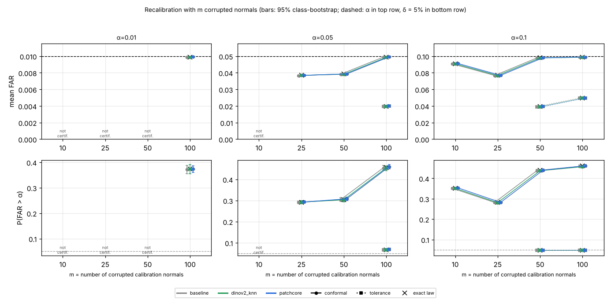

# Conformal False-Alarm Calibration for Industrial Anomaly Detection under Distribution Shift

[](https://github.com/shayansalehi1381/anomaly-calibration/actions/workflows/ci.yml)


A deployed anomaly detector needs a **threshold**, and what operators feel is the **false-alarm rate (FAR)** on good parts.
This project calibrates that threshold on normal images only (split conformal prediction and a PAC tolerance limit) and
measures whether it **keeps its target FAR under distribution shift** (brightness, blur, noise, JPEG) for three detectors
on **VisA**: a feature-distance baseline, PatchCore and DINOv2-kNN.
**Reproduction plus extension; no novelty claim** (prior work below).

**Where to start:** this README, [`docs/RESULTS_SUMMARY.md`](docs/RESULTS_SUMMARY.md) (every number with its source) and
[`notebooks/results.ipynb`](notebooks/results.ipynb) (tables and figures, CPU only).

## TL;DR

*Research question:* do conformally calibrated thresholds keep their target FAR (α = 1%, 5%, 10%) under distribution shift,
and which method keeps it most stably?

- **Clean data: yes.** Split-conformal FAR at α = 5% is 4.6–4.7% for all three detectors, matching the exact theory (measured).
- **Under shift without recalibration: no, almost immediately.** At α = 5%, PatchCore's FAR at level 1 is 28% (brightness) to 100%
  (noise, JPEG); by level 3 it is ≥ 95% everywhere (measured; our corruptions are synthetic and strong).
- **With recalibration on corrupted normals: yes, exactly** (FAR 4.5–4.6%), **but the detectors lose most of their detection
  rate** (TPR 39–65% on clean images → 6–28% at level 5). The guarantee comes back; the useful detector does not.
- **Most stable method: DINOv2-kNN**, then PatchCore, then the baseline. Paired class-bootstrap intervals exclude 0 for
  DINOv2-kNN vs both others (−0.11 and −0.14 RMS excess FAR). PatchCore vs baseline is a small effect (−0.03). All three still fail.
- **A threshold needs enough normals:** with m = 10–100 corrupted normals the *average* FAR still holds, but conformal exceeds α in
  28–46% of calibration sets; the tolerance limit keeps that near 5% but cannot certify α = 1% (needs 299 normals).

## Prior work

- **Deng, arXiv:2608.15090**: one-sided order-statistic **tolerance limit** for FAR calibration (PAC guarantee). Our "tolerance limit"
  is his, credited; we reproduce his primary setting (m = 150, α = 0.10, δ = 0.05 → rank 142, confidence 0.9693). He does **not** test shift.
- **SPARC, arXiv:2608.18585**: corrects *features* under shift from ≤ 8 normals; reports AUROC/AU-PRO only, **no threshold
  guarantee**; classifies VisA as shift-free. Its VisA AUROC is used only as a sanity check.
- **What we add:** how split-conformal and tolerance-limit thresholds behave under controlled synthetic shift on VisA, and how much
  recalibration on shifted normals restores. Details: [`docs/PRIOR_WORK.md`](docs/PRIOR_WORK.md).

## Setup

- **Data:** VisA, 12 classes, 9,621 normal + 1,200 anomalous images. Per class, official *train* normals are split into a memory
  bank (½) and a held-out pool; the official *test* normals join the pool. Calibration and test halves are drawn from the pool
  (50/50, R = 100 random partitions, 3 seeds): calibration, test and memory images are disjoint (tested).
  [`docs/SPLIT_PROTOCOL.md`](docs/SPLIT_PROTOCOL.md).
- **Detectors** (our lean implementations, [`docs/MODELS.md`](docs/MODELS.md)): baseline (WRN-50 global features, nearest memory
  image), PatchCore (WRN-50 layer2+3, 10% coreset), DINOv2-kNN (ViT-S/14 patch tokens, 224 px). Clean image AUROC on our split: 80.0 / 89.8 / 89.6 (measured).
- **Calibration math** (split conformal; anomalies never enter calibration): with n normal calibration scores, take the
  k-th smallest, k = ⌈(n+1)(1−α)⌉, as threshold; alarm iff score > threshold. If calibration and test normals are exchangeable,
  α − 1/(n+1) ≤ E[FAR] ≤ α, and the FAR of one calibration set follows Beta(n+1−k, k). If k > n it is **not certifiable**
  (n < 1/α − 1) and we output no threshold, never a clamp. The tolerance limit (Deng) takes the smallest rank r with
  Pr{Bin(m, α) ≥ m−r+1} ≥ 1−δ and guarantees Pr[FAR ≤ α] ≥ 1−δ; it needs m ≥ 29 / 59 / 299 normals for α = 10% / 5% / 1% (δ = 5%).
  Derivations: [`docs/INTERVIEW_NOTES.md`](docs/INTERVIEW_NOTES.md).
- **Synthetic shifts** (applied on the laptop, deterministic): brightness, Gaussian blur, Gaussian noise, JPEG at ImageNet-C
  levels 1, 3, 5, **plus one extra mild level we defined (shown at x = 0.5, stored as `severity = −1`; not an ImageNet-C level)**:
  brightness +0.05, blur σ 0.5 px, noise std 0.04, JPEG quality 50. Parameters: `src/anomcal/corruptions.py`.
- **Settings:** **A** = threshold from *clean* calibration normals, tested on corrupted test normals (exchangeability is
  broken by construction); **B** = threshold from *corrupted* calibration normals of the same condition (needs normal images
  under the new condition).

## Results (all measured; sources and estimates: [`docs/RESULTS_SUMMARY.md`](docs/RESULTS_SUMMARY.md))

### Headline: split conformal, α = 5%

Mean over 12 classes. Cell = FAR (excess FAR = FAR − 0.05). Clean FAR is 0.046 (−0.004). B is on target at every level
(0.045–0.046). TPR = detection rate on corrupted anomalies at that threshold (clean TPR: 0.39 / 0.64 / 0.65).
95% class-bootstrap intervals, α = 1% and 10%, and the tolerance limit are in `results/phase4/headline.csv`.

| corruption | method | A @0.5 | A @1 | A @5 | B @1 | TPR @1: A / B |
|---|---|---|---|---|---|---|
| brightness | baseline | 0.183 (+0.133) <!-- check: phase4/headline.csv ;; far ;; method=baseline,corruption=brightness,kind=conformal,alpha=0.05,setting=A_no_recal,level=0.5 ;; 0.18334 ;; 0.0006 --> | 0.494 (+0.444) <!-- check: phase4/headline.csv ;; far ;; method=baseline,corruption=brightness,kind=conformal,alpha=0.05,setting=A_no_recal,level=1.0 ;; 0.49402 ;; 0.0006 --> | 1.000 (+0.950) <!-- check: phase4/headline.csv ;; far ;; method=baseline,corruption=brightness,kind=conformal,alpha=0.05,setting=A_no_recal,level=5.0 ;; 1 ;; 0.0006 --> | 0.046 (-0.004) <!-- check: phase4/headline.csv ;; far ;; method=baseline,corruption=brightness,kind=conformal,alpha=0.05,setting=B_recal,level=1.0 ;; 0.045782 ;; 0.0006 --> | 0.72 / 0.31 |
| brightness | DINOv2-kNN | 0.053 (+0.003) <!-- check: phase4/headline.csv ;; far ;; method=dinov2_knn,corruption=brightness,kind=conformal,alpha=0.05,setting=A_no_recal,level=0.5 ;; 0.053183 ;; 0.0006 --> | 0.104 (+0.054) <!-- check: phase4/headline.csv ;; far ;; method=dinov2_knn,corruption=brightness,kind=conformal,alpha=0.05,setting=A_no_recal,level=1.0 ;; 0.10405 ;; 0.0006 --> | 0.773 (+0.723) <!-- check: phase4/headline.csv ;; far ;; method=dinov2_knn,corruption=brightness,kind=conformal,alpha=0.05,setting=A_no_recal,level=5.0 ;; 0.773 ;; 0.0006 --> | 0.045 (-0.005) <!-- check: phase4/headline.csv ;; far ;; method=dinov2_knn,corruption=brightness,kind=conformal,alpha=0.05,setting=B_recal,level=1.0 ;; 0.045444 ;; 0.0006 --> | 0.63 / 0.57 |
| brightness | PatchCore | 0.095 (+0.045) <!-- check: phase4/headline.csv ;; far ;; method=patchcore,corruption=brightness,kind=conformal,alpha=0.05,setting=A_no_recal,level=0.5 ;; 0.094575 ;; 0.0006 --> | 0.279 (+0.229) <!-- check: phase4/headline.csv ;; far ;; method=patchcore,corruption=brightness,kind=conformal,alpha=0.05,setting=A_no_recal,level=1.0 ;; 0.27943 ;; 0.0006 --> | 1.000 (+0.950) <!-- check: phase4/headline.csv ;; far ;; method=patchcore,corruption=brightness,kind=conformal,alpha=0.05,setting=A_no_recal,level=5.0 ;; 0.99999 ;; 0.0006 --> | 0.046 (-0.004) <!-- check: phase4/headline.csv ;; far ;; method=patchcore,corruption=brightness,kind=conformal,alpha=0.05,setting=B_recal,level=1.0 ;; 0.046055 ;; 0.0006 --> | 0.72 / 0.60 |
| gaussian_blur | baseline | 0.142 (+0.092) <!-- check: phase4/headline.csv ;; far ;; method=baseline,corruption=gaussian_blur,kind=conformal,alpha=0.05,setting=A_no_recal,level=0.5 ;; 0.1424 ;; 0.0006 --> | 0.955 (+0.905) <!-- check: phase4/headline.csv ;; far ;; method=baseline,corruption=gaussian_blur,kind=conformal,alpha=0.05,setting=A_no_recal,level=1.0 ;; 0.95545 ;; 0.0006 --> | 1.000 (+0.950) <!-- check: phase4/headline.csv ;; far ;; method=baseline,corruption=gaussian_blur,kind=conformal,alpha=0.05,setting=A_no_recal,level=5.0 ;; 1 ;; 0.0006 --> | 0.046 (-0.004) <!-- check: phase4/headline.csv ;; far ;; method=baseline,corruption=gaussian_blur,kind=conformal,alpha=0.05,setting=B_recal,level=1.0 ;; 0.04581 ;; 0.0006 --> | 0.98 / 0.17 |
| gaussian_blur | DINOv2-kNN | 0.051 (+0.001) <!-- check: phase4/headline.csv ;; far ;; method=dinov2_knn,corruption=gaussian_blur,kind=conformal,alpha=0.05,setting=A_no_recal,level=0.5 ;; 0.051484 ;; 0.0006 --> | 0.160 (+0.110) <!-- check: phase4/headline.csv ;; far ;; method=dinov2_knn,corruption=gaussian_blur,kind=conformal,alpha=0.05,setting=A_no_recal,level=1.0 ;; 0.15984 ;; 0.0006 --> | 1.000 (+0.950) <!-- check: phase4/headline.csv ;; far ;; method=dinov2_knn,corruption=gaussian_blur,kind=conformal,alpha=0.05,setting=A_no_recal,level=5.0 ;; 1 ;; 0.0006 --> | 0.045 (-0.005) <!-- check: phase4/headline.csv ;; far ;; method=dinov2_knn,corruption=gaussian_blur,kind=conformal,alpha=0.05,setting=B_recal,level=1.0 ;; 0.045164 ;; 0.0006 --> | 0.70 / 0.57 |
| gaussian_blur | PatchCore | 0.058 (+0.008) <!-- check: phase4/headline.csv ;; far ;; method=patchcore,corruption=gaussian_blur,kind=conformal,alpha=0.05,setting=A_no_recal,level=0.5 ;; 0.058078 ;; 0.0006 --> | 0.831 (+0.781) <!-- check: phase4/headline.csv ;; far ;; method=patchcore,corruption=gaussian_blur,kind=conformal,alpha=0.05,setting=A_no_recal,level=1.0 ;; 0.83098 ;; 0.0006 --> | 1.000 (+0.950) <!-- check: phase4/headline.csv ;; far ;; method=patchcore,corruption=gaussian_blur,kind=conformal,alpha=0.05,setting=A_no_recal,level=5.0 ;; 1 ;; 0.0006 --> | 0.045 (-0.005) <!-- check: phase4/headline.csv ;; far ;; method=patchcore,corruption=gaussian_blur,kind=conformal,alpha=0.05,setting=B_recal,level=1.0 ;; 0.045433 ;; 0.0006 --> | 0.98 / 0.61 |
| gaussian_noise | baseline | 0.975 (+0.925) <!-- check: phase4/headline.csv ;; far ;; method=baseline,corruption=gaussian_noise,kind=conformal,alpha=0.05,setting=A_no_recal,level=0.5 ;; 0.97504 ;; 0.0006 --> | 1.000 (+0.950) <!-- check: phase4/headline.csv ;; far ;; method=baseline,corruption=gaussian_noise,kind=conformal,alpha=0.05,setting=A_no_recal,level=1.0 ;; 0.99991 ;; 0.0006 --> | 1.000 (+0.950) <!-- check: phase4/headline.csv ;; far ;; method=baseline,corruption=gaussian_noise,kind=conformal,alpha=0.05,setting=A_no_recal,level=5.0 ;; 1 ;; 0.0006 --> | 0.046 (-0.004) <!-- check: phase4/headline.csv ;; far ;; method=baseline,corruption=gaussian_noise,kind=conformal,alpha=0.05,setting=B_recal,level=1.0 ;; 0.045607 ;; 0.0006 --> | 1.00 / 0.14 |
| gaussian_noise | DINOv2-kNN | 0.582 (+0.532) <!-- check: phase4/headline.csv ;; far ;; method=dinov2_knn,corruption=gaussian_noise,kind=conformal,alpha=0.05,setting=A_no_recal,level=0.5 ;; 0.58212 ;; 0.0006 --> | 0.904 (+0.854) <!-- check: phase4/headline.csv ;; far ;; method=dinov2_knn,corruption=gaussian_noise,kind=conformal,alpha=0.05,setting=A_no_recal,level=1.0 ;; 0.90373 ;; 0.0006 --> | 1.000 (+0.950) <!-- check: phase4/headline.csv ;; far ;; method=dinov2_knn,corruption=gaussian_noise,kind=conformal,alpha=0.05,setting=A_no_recal,level=5.0 ;; 1 ;; 0.0006 --> | 0.045 (-0.005) <!-- check: phase4/headline.csv ;; far ;; method=dinov2_knn,corruption=gaussian_noise,kind=conformal,alpha=0.05,setting=B_recal,level=1.0 ;; 0.045448 ;; 0.0006 --> | 0.97 / 0.25 |
| gaussian_noise | PatchCore | 0.847 (+0.797) <!-- check: phase4/headline.csv ;; far ;; method=patchcore,corruption=gaussian_noise,kind=conformal,alpha=0.05,setting=A_no_recal,level=0.5 ;; 0.8471 ;; 0.0006 --> | 1.000 (+0.950) <!-- check: phase4/headline.csv ;; far ;; method=patchcore,corruption=gaussian_noise,kind=conformal,alpha=0.05,setting=A_no_recal,level=1.0 ;; 1 ;; 0.0006 --> | 1.000 (+0.950) <!-- check: phase4/headline.csv ;; far ;; method=patchcore,corruption=gaussian_noise,kind=conformal,alpha=0.05,setting=A_no_recal,level=5.0 ;; 1 ;; 0.0006 --> | 0.045 (-0.005) <!-- check: phase4/headline.csv ;; far ;; method=patchcore,corruption=gaussian_noise,kind=conformal,alpha=0.05,setting=B_recal,level=1.0 ;; 0.04549 ;; 0.0006 --> | 1.00 / 0.36 |
| jpeg_compression | baseline | 0.966 (+0.916) <!-- check: phase4/headline.csv ;; far ;; method=baseline,corruption=jpeg_compression,kind=conformal,alpha=0.05,setting=A_no_recal,level=0.5 ;; 0.96562 ;; 0.0006 --> | 1.000 (+0.950) <!-- check: phase4/headline.csv ;; far ;; method=baseline,corruption=jpeg_compression,kind=conformal,alpha=0.05,setting=A_no_recal,level=1.0 ;; 0.99984 ;; 0.0006 --> | 1.000 (+0.950) <!-- check: phase4/headline.csv ;; far ;; method=baseline,corruption=jpeg_compression,kind=conformal,alpha=0.05,setting=A_no_recal,level=5.0 ;; 1 ;; 0.0006 --> | 0.046 (-0.004) <!-- check: phase4/headline.csv ;; far ;; method=baseline,corruption=jpeg_compression,kind=conformal,alpha=0.05,setting=B_recal,level=1.0 ;; 0.046004 ;; 0.0006 --> | 1.00 / 0.18 |
| jpeg_compression | DINOv2-kNN | 0.409 (+0.359) <!-- check: phase4/headline.csv ;; far ;; method=dinov2_knn,corruption=jpeg_compression,kind=conformal,alpha=0.05,setting=A_no_recal,level=0.5 ;; 0.40912 ;; 0.0006 --> | 0.741 (+0.691) <!-- check: phase4/headline.csv ;; far ;; method=dinov2_knn,corruption=jpeg_compression,kind=conformal,alpha=0.05,setting=A_no_recal,level=1.0 ;; 0.74133 ;; 0.0006 --> | 1.000 (+0.950) <!-- check: phase4/headline.csv ;; far ;; method=dinov2_knn,corruption=jpeg_compression,kind=conformal,alpha=0.05,setting=A_no_recal,level=5.0 ;; 1 ;; 0.0006 --> | 0.045 (-0.005) <!-- check: phase4/headline.csv ;; far ;; method=dinov2_knn,corruption=jpeg_compression,kind=conformal,alpha=0.05,setting=B_recal,level=1.0 ;; 0.045328 ;; 0.0006 --> | 0.91 / 0.30 |
| jpeg_compression | PatchCore | 0.819 (+0.769) <!-- check: phase4/headline.csv ;; far ;; method=patchcore,corruption=jpeg_compression,kind=conformal,alpha=0.05,setting=A_no_recal,level=0.5 ;; 0.81944 ;; 0.0006 --> | 1.000 (+0.950) <!-- check: phase4/headline.csv ;; far ;; method=patchcore,corruption=jpeg_compression,kind=conformal,alpha=0.05,setting=A_no_recal,level=1.0 ;; 0.99993 ;; 0.0006 --> | 1.000 (+0.950) <!-- check: phase4/headline.csv ;; far ;; method=patchcore,corruption=jpeg_compression,kind=conformal,alpha=0.05,setting=A_no_recal,level=5.0 ;; 1 ;; 0.0006 --> | 0.046 (-0.004) <!-- check: phase4/headline.csv ;; far ;; method=patchcore,corruption=jpeg_compression,kind=conformal,alpha=0.05,setting=B_recal,level=1.0 ;; 0.045856 ;; 0.0006 --> | 1.00 / 0.28 |


- **Graded curve:** brightness and blur: yes (near α at 0.5, leaving α at level 1). **Noise and JPEG: no.** They are already far above α at
  the mildest level we have (baseline 97–98%, PatchCore 82–85%, DINOv2-kNN 58% / 41%), so where they first break is unmeasured.
  We did not test why.
- **Violation rate** (share of partitions with FAR > α, all 16 conditions, all certifiable α): 77–98% without recalibration; with it 29–43% for
  conformal (expected: the guarantee is on the *average*) and 8.5–10% for the tolerance limit.

### Which method is most stable?

RMS of (FAR − α) over the shifted conditions and 12 classes (0 = target kept everywhere; **rank by distance from the target, not by
spread across classes**: the baseline has the smallest spread only because it fails the same way in every class).
Setting A, conformal α = 5%, all 16 shifted conditions (levels 0.5, 1, 3, 5):

| method | RMS excess [95% class bootstrap] | spread across classes |
|---|---|---|
| DINOv2-kNN | 0.721 [0.681, 0.757] <!-- check: phase4/stability.csv ;; rms_excess ;; grid=all,setting=A_no_recal,kind=conformal,alpha=0.05,method=dinov2_knn ;; 0.721 ;; 0.0006 --> | 0.155 |
| PatchCore | 0.833 [0.818, 0.849] <!-- check: phase4/stability.csv ;; rms_excess ;; grid=all,setting=A_no_recal,kind=conformal,alpha=0.05,method=patchcore ;; 0.833 ;; 0.0006 --> | 0.079 |
| baseline | 0.863 [0.851, 0.877] <!-- check: phase4/stability.csv ;; rms_excess ;; grid=all,setting=A_no_recal,kind=conformal,alpha=0.05,method=baseline ;; 0.863 ;; 0.0006 --> | 0.058 |

**Paired comparison** (same resampled classes for both methods; difference of RMS excess, negative = first is closer):
DINOv2-kNN − PatchCore **−0.112 [−0.142, −0.085]**, DINOv2-kNN − baseline **−0.142 [−0.179, −0.110]**,
PatchCore − baseline **−0.030 [−0.044, −0.017]**. In Setting A the interval excludes 0 in all 30 (grid, threshold, α, pair) cells,
also on the 12 ImageNet-C conditions alone. So DINOv2-kNN is clearly ahead; PatchCore over baseline is small (0.01–0.05 on a scale of
0.7–0.9). In Setting B all methods are tied (|difference| ≤ 0.0006).
Earlier (levels 1/3/5 only) numbers were 0.80 / 0.90 / 0.92. The intervals cover which classes were drawn; see Limitations.

### Per-class check

The mean hides classes. At level 0.5 (brightness, Setting A) PatchCore's mean FAR is 9.5%, but 2 of 12 classes are above 10% (worst 34%);
the baseline has 6 of 12 above 10% (worst 83%); DINOv2-kNN none (worst 8.4%). At level 1, PatchCore brightness FAR is 6–8% for seven classes and
96–100% for chewinggum and pipe_fryum. Macaroni2 and capsules (weak PatchCore classes, AUROC 56–59 and 70–73) stay near α in
some conditions: that reflects weak detectors, not good calibration. Table: `docs/RESULTS_SUMMARY.md` §5, `results/phase4/per_class.csv`.

### Small calibration sets (Setting B′; levels 1/3/5 only, not rerun with the mild level)

Threshold from only m corrupted calibration normals (500 draws per experiment and condition). Observed FAR and violation rates match the exact
Beta-binomial law to ≤ 0.1 point (it checks the code, not the detectors). Conformal α = 5%: m = 25 → mean FAR 3.8%, 29% of draws above α;
m = 100 → 4.9%, 46%. Tolerance limit α = 10%, m = 50 → FAR 3.9%, 4.7% of draws above α, but a lower TPR. Not certifiable (explicit status,
never clamped): conformal α = 1% needs m ≥ 99, α = 5% needs m ≥ 19; the tolerance limit needs 29 / 59 / 299.



### Clean calibration (Phase 3)

108 experiments × 100 random partitions. Pooled conformal FAR: 4.69% / 4.61% / 4.67% at α = 5% (baseline / DINOv2-kNN / PatchCore; theory 4.58%), but
29–45% of single partitions exceed α (theory 29–43%): the guarantee is an average. A cross-split check (calibrate on train normals, test on official test normals)
gives 11.4% / 10.9% at α = 10% for DINOv2-kNN / PatchCore (expected 9.9%): a weak hint of a small natural shift. Details: `docs/RESULTS_SUMMARY.md`.

## Limitations

- **Synthetic shifts only.** VisA has no engineered shift (SPARC classes it shift-free). Our corruptions are strong stand-ins; real shifts (new lot, camera, lighting)
  may behave differently. No claim about natural shift.
- **VisA only**, 12 classes, three detectors (our lean re-implementations, not reference code), one resolution (256 px canonical).
- **Intervals do not cover within-class image sampling.** The class bootstrap covers which classes were drawn; each class has only 138–277 test normals and the 100
  partitions reuse them. It does not cover other datasets, other corruption strengths, or the synthetic nature of the shift. With 12 classes it is itself rough.
- **Exchangeability is violated by construction in Setting A**, so "the guarantee fails" is expected; we measure by how much.
- **No causal claims.** We did not test why noise std 0.04 or JPEG quality 50 already break the threshold, nor why DINOv2-kNN drifts less than the others.
- **Weak classes:** macaroni2 (PatchCore AUROC 55.7–59.4) and capsules (70.2–73.4). Papers reportedly find them hard for PatchCore too; unverified by us.
- **Unexplained DINOv2 gap vs SPARC:** our DINOv2-kNN reaches 89.6 image AUROC vs ≈ 95.3 for AnomalyDINO (−5.7) at 224 px; PatchCore 90.0 vs ≈ 94.3 (−4.3).
  Preprocessing differs (resize vs center crop); hypotheses (input size, aggregation, masking) are untested.
- **Memory bank is half the usual size** (we enlarge the normal pool). Halving it changes class-mean AUROC by at most 0.4 points (measured).
- **Small-m results** use the 12 original conditions only. Tolerance limit at α = 1% cannot be certified with our 138–277 calibration normals.
- **Estimates vs measurements:** only the laptop run-time predictions are estimates (RESULTS_SUMMARY §8).

## Reproducibility

The dataset never leaves the laptop; only small score files, CSVs and figures are committed (CI guard: `python -m anomcal.repo_guard`, 5 MiB per file).

**Cloud / any machine, CPU only** (no dataset, GPU or network):

```bash
pip install -e ".[plots,dev]"
ruff check . && ruff format --check .
python -m pytest -q                        # offline suite, synthetic data only
python -m anomcal.repo_guard
python -m anomcal.phase3                   # clean calibration, about 1 min  -> results/phase3/
python -m anomcal.phase4                   # shift analysis + 2 figures, about 30 s -> results/phase4/
python -m anomcal.phase4m                  # small-m recalibration, about 75 s
python scripts/make_results_summary.py     # regenerate docs/RESULTS_SUMMARY.md
pip install -e ".[notebook]" && jupyter nbconvert --to notebook --execute --inplace notebooks/results.ipynb
```

**Laptop with a GPU** (Windows, RTX 3060 6 GB; only feature extraction and scoring; VisA extracted to `data\visa\`):

```powershell
pip install torch==2.14.1 torchvision==0.29.1 --index-url https://download.pytorch.org/whl/cu126   # or cu130, see docs/LAPTOP_GPU_RUN.md
pip install timm==1.0.30
pip install -e ".[gpu,plots,dev]"
python -m anomcal.data.visa --data-root data\visa                      # verify the local copy
python scripts\extract_scores.py --config configs\gpu_smoke.json       # smoke test
python scripts\extract_scores.py --config configs\full_run.json        # full run, resumable (3 h 53 min measured)
python scripts\extract_scores.py --config configs\extra_mild_level.json  # extra mild level only (1 h 05 min measured)
```

Guides: [`docs/LAPTOP_GPU_RUN.md`](docs/LAPTOP_GPU_RUN.md), [`docs/score_schema.md`](docs/score_schema.md). A tiny synthetic VisA stand-in:
`python -m anomcal.data.fake_visa outputs/fake_visa`.

## What I would do next

1. SPARC-style feature correction from a few lot normals, then conformal calibration on the corrected scores (does it beat plain recalibration?).
2. Natural-shift data: MVTec AD 2 and AeBAD-S (licences to verify), and real shifts (new lot, camera, lighting).
3. A finer severity grid below ImageNet-C level 1 (noise std 0.01–0.03, JPEG quality 60–90) to see where noise and JPEG first break the threshold.
4. Small-m recalibration with the mild level, within-class (image-level) bootstrap, and a score-shift detector that flags when to recalibrate.

## Repository guide

```
src/anomcal/   calibration.py (thresholds, written by us), phase3/phase4/phase4m.py (analysis), corruptions.py, scorers/, extract.py (laptop)
scripts/       extract_scores.py, estimate_full_run.py, auroc_table.py, make_results_summary.py
results/       scores/ (small parquet), phase3/, phase4/ (CSVs), provenance/ (run metadata)
docs/          RESULTS_SUMMARY.md, INTERVIEW_NOTES.md (decisions, math, what failed), SPLIT_PROTOCOL.md, PRIOR_WORK.md, MODELS.md, laptop guides
notebooks/     results.ipynb      tests/  offline suite      ROADMAP.md  phase plan (all phases done)
```

## References and licences

Annotated list: [`docs/PRIOR_WORK.md`](docs/PRIOR_WORK.md).

- Deng. *Distribution-free false-alarm calibration and chance-corrected spatial evaluation for industrial anomaly detection.* arXiv:2608.15090.
- Han, Chu, Nowak, Chin. *SPARC: Subspace Position-Aware Robust Few-Shot Calibration for Distribution-Shifted Industrial Anomaly Detection.* arXiv:2608.18585.
- Roth et al. *Towards Total Recall in Industrial Anomaly Detection* (PatchCore). CVPR 2022. · Defard et al. *PaDiM.* ICPR Workshops 2021.
- Oquab et al. *DINOv2.* TMLR 2024. · Damm et al. *AnomalyDINO.* WACV 2025.
- Vovk, Gammerman, Shafer. *Algorithmic Learning in a Random World.* Springer 2005. · Vovk. *Conditional validity of inductive conformal predictors.* ACML 2012.
- Angelopoulos, Bates. *A gentle introduction to conformal prediction.* arXiv:2107.07511. · Bates et al. *Testing for outliers with conformal p-values.* Ann. Stat. 2023.
- Laxhammar, Falkman. *Inductive conformal anomaly detection…* Ann. Math. Artif. Intell. 2015. · Tibshirani et al. *Conformal prediction under covariate shift.* NeurIPS 2019. · Barber et al. *Conformal prediction beyond exchangeability.* Ann. Stat. 2023.
- Hendrycks, Dietterich. *Benchmarking neural network robustness to common corruptions and perturbations* (ImageNet-C). ICLR 2019. · Wilson. JASA 22(158), 1927.
- **VisA:** Zou, Jeong, Pemula, Zhang, Dabeer. *SPot-the-Difference Self-Supervised Pre-training for Anomaly Detection and Segmentation.* ECCV 2022, arXiv:2207.14315.
  Dataset licence: the release page (github.com/amazon-science/spot-diff) states "The data is released under the CC BY 4.0 license" (read once through a summarising web fetch,
  not byte-verified). The release's BibTeX entry (key `zou2022spot`, arXiv:2207.14315, 2022) was **not** verified verbatim: copy it from the release page before citing. VisA is not redistributed here.
- Code: MIT. Licences of pretrained weights (torchvision/timm WRN-50, DINOv2 ViT-S/14): not checked here.
